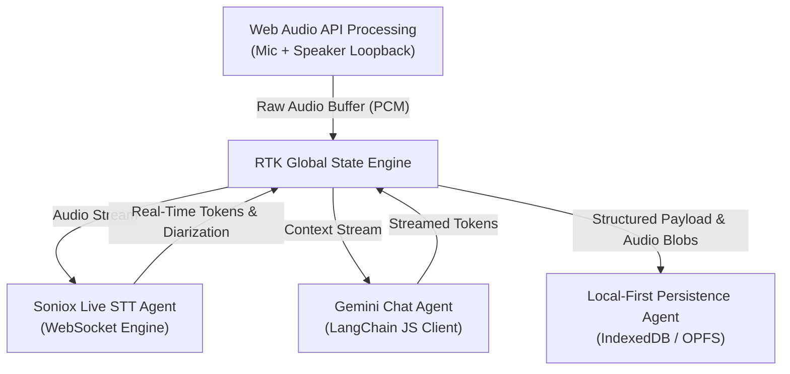
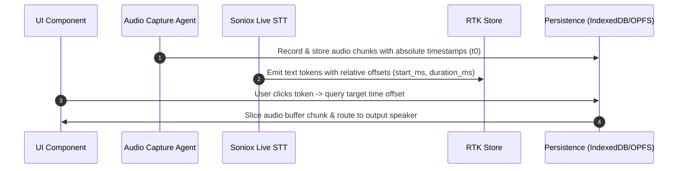
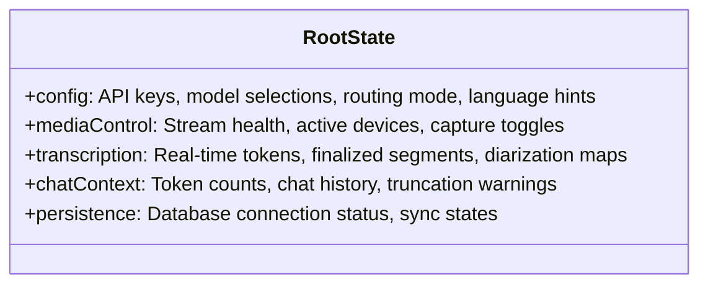

# Technical Architecture & Client-Side Agents Specification (`AGENTS.md`)

Local-first, browser-sandbox real-time transcription, diarization, translation, playback, and AI chat. Zero backend server required.

---

## 1. System Architecture Overview

Decoupled, reactive event-driven architecture orchestrated via **Redux Toolkit (RTK)**. Streaming AI services connect directly via client WebSockets / SDKs; persistence is handled in-browser via **IndexedDB** / **OPFS**.



---

## 2. Agent Breakdowns & Core Responsibilities

### 2.1 Configuration & Validation Agent (Settings Module)
- **Tech Stack:** `react-hook-form`, `zod`, `@reduxjs/toolkit`
- **Responsibilities:**
  - Securely validate API credentials in reactive memory.
  - Enforce defaults (`gemini-3.8-flash`, `stt-rt-v5`).
  - Propagate audio routing and language configuration changes to active streams.

```typescript
// Zod Schema Verification Layer
export const SettingsSchema = zod.object({
  sonioxApiKey: zod.string().min(1, "Soniox API Key is required"),
  googleApiKey: zod.string().min(1, "Google AI API Key is required"),
  aiModel: zod.string().default("gemini-3.8-flash"),
  transcriptionModel: zod.string().default("stt-rt-v5"),
  languageHints: zod.array(z.string()).default(["en", "id"]),
  enableEndpointDetection: zod.boolean().default(true),
  enableLanguageIdentification: zod.boolean().default(true),
  enableTranslation: z.boolean().default(false),
  translationMode: zod.enum(["one-way", "two-way"]).default("two-way"),
  translationTargetLanguage: z.string().default("en"),
  translationLanguageA: z.string().default("en"),
  translationLanguageB: z.string().default("id"),
  audioRouting: zod
    .enum(["mix", "mic-only", "speaker-only"])
    .default("mic-only"),
});
```

---

### 2.2 Audio Capture & Routing Agent
- **Tech Stack:** Web Audio API (`AudioContext`, `MediaStreamAudioSourceNode`, `AudioWorklet`)
- **Responsibilities:**
  - Capture microphone (`navigator.mediaDevices.getUserMedia`).
  - Capture system/speaker output loopback (`navigator.mediaDevices.getDisplayMedia`).
  - **Routing Modes:**
    - `mix`: Downmix mic and speaker tracks into a uniform mono/stereo linear PCM stream (16kHz or 44.1kHz).
    - `mic-only` / `speaker-only`: Forward the selected stream directly without mixing.

---

### 2.3 Soniox Live Transcription Agent
- **Tech Stack:** Native Browser `WebSocket` client, RTK Async Thunks
- **Endpoint:** `wss://api.soniox.com/v1/stream`
- **Responsibilities:**
  - Establish high-frequency binary stream pipeline with dynamic header configuration (translation profiles, channel masks, language IDs).
  - Stream word-level timestamps (`start_ms`, `duration_ms`), speaker diarization tags, and translations.
  - Append incremental tokens cleanly to RTK state without triggering excessive DOM re-renders.
  - **Rendering Strategy:** Display unfinalized (`isFinal == false`) stream in real-time, then refine layout once finalized (`isFinal == true`) using distinct styles to avoid jagged spacing.

---

### 2.4 Context & Token Manager Agent
- **Tech Stack:** `langchain/llms/base`, `@langchain/core/tokens`
- **Responsibilities:**
  - Track transcript mutations and estimate token count using Gemini-compatible tokenizer logic.
  - **Guardrails:**
    - **≥ 85% capacity:** Dispatch global warning banner in UI.
    - **≥ 100% capacity:** Execute smart FIFO (First-In, First-Out) truncation preserving complete speaker turn boundaries.

---

### 2.5 Gemini Chat Agent
- **Tech Stack:** `@langchain/google-genai`, `langchain/prompts`
- **Responsibilities:**
  - Instantiate localized `ChatGoogleGenerativeAI` dynamically with credentials from config.
  - Compile chat prompt with transcript context, history, and user question.
  - Stream tokens directly to UI elements via async iterators.

```typescript
// Prompt Execution Pipeline
const promptTemplate = ChatPromptTemplate.fromMessages([
  [
    "system",
    "You are an AI Assistant answering queries based on the following real-time transcript:\n\n{context}",
  ],
  ["placeholder", "{chat_history}"],
  ["human", "{question}"],
]);
```

---

### 2.6 Local-First Persistence Agent
- **Tech Stack:** `Prisma Client (WASM / Driver Adapter)`, `@electric-sql/pglite` / IndexedDB, Web Origin Private File System (OPFS)
- **Responsibilities:**
  - Persist sessions, transcripts, translations, speaker tags, and Q&A pairs.
  - Stream raw binary audio buffers directly into OPFS / IndexedDB chunk allocations to prevent memory leaks.
  - Maintain ACID transaction guarantees for timestamped records.

---

## 3. Advanced Features & Data Schema

### 3.1 Token-Level Audio Playback (Audio Scrubbing)

Correlates text tokens with audio intervals to play the exact split-second of audio on click:



---

### 3.2 Relational Local Storage Schema (Prisma Blueprint)

```prisma
datasource db {
  provider = "postgresql"
  url      = "file:local.db"
}

model Session {
  id             String       @id @default(uuid())
  createdAt      DateTime     @default(now())
  title          String?
  audioBlobPath  String       // Path/key in browser storage/OPFS
  transcripts    Transcript[]
  chatPairs      ChatPair[]
}

model Transcript {
  id                String   @id @default(uuid())
  sessionId         String
  session           Session  @relation(fields: [sessionId], references: [id], onDelete: Cascade)
  speakerId         String   // Diarization identity ("Speaker 1", "Speaker 2")
  text              String   // Original transcribed text
  isFinal           Boolean  // Finalized segment indicator
  translationStatus String   // Status of translation pipeline
  language          String   // Detected / transcribed language
  translation       String?  // Target language translation
  startTimestamp    Int      // Milliseconds from session start
  endTimestamp      Int      // Milliseconds from session start
  offsetTimestamp   Int      // Offset timestamp of segment
  duration          Int      // Duration in milliseconds
}

model ChatPair {
  id        String   @id @default(uuid())
  sessionId String
  session   Session  @relation(fields: [sessionId], references: [id], onDelete: Cascade)
  question  String
  answer    String
  timestamp DateTime @default(now())
}
```

---

## 4. Global State Layout (Redux Toolkit Slices)



---

## 5. UI/UX Layout Strategies

- **Mobile-First Responsive Layout:** Secondary controls and configuration reside in slide-out drawers (`HeroUI Drawer`), reserving viewport space for single-column live transcription.
- **Scroll Pinning & Mutation Safety:** Auto-scroll keeps latest text in view by anchoring to viewport bottom. Manual upward scrolling automatically pauses auto-scroll to allow reading history and audio scrubbing without layout jumps.
- **Atomic Design:** Strict reusable atomic component hierarchy.

---

## 6. End-to-End Testing

- **Engine:** Playwright.
- **Coverage:** Full user journey mimicking real-world conditions:
  - Hardware setup & recording initiation (mic, loopback, mix).
  - Real-time streaming token reception & text finalization styling.
  - Multi-language translation streams.
  - Token click-to-playback scrubbing accuracy.
  - FIFO context threshold alerts (85%) & truncation (100%).
  - In-browser AI chat streaming with session transcript context.
  - IndexedDB session persistence & reload integrity.
