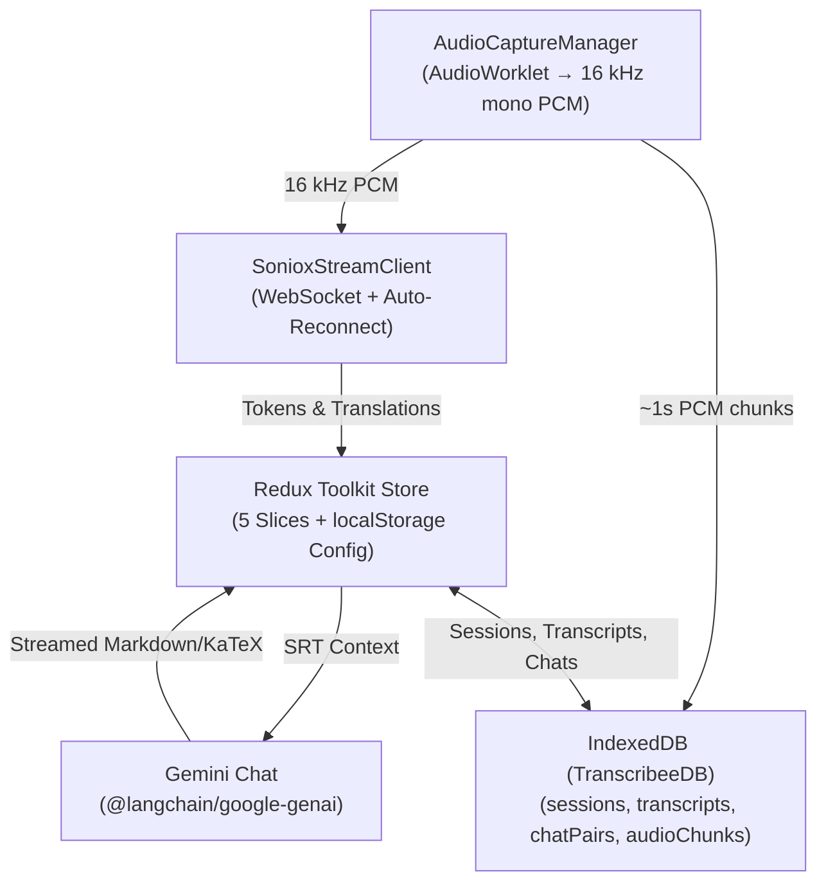

# AGENTS.md

Local-first, browser-only real-time transcription, speaker diarization, live translation, synchronized audio playback, and AI chat. Zero backend server required.

## Stack & Commands

- **Stack:** Next.js 16 (App Router, `reactCompiler: true`), React 19, TypeScript, Tailwind CSS 4, Redux Toolkit, React Hook Form + Zod v4, `@langchain/google-genai`, native IndexedDB, Bun + Playwright.
- **Commands:** `bun run dev` | `bun run build` | `bun run lint` | `bun run test:unit` | `bun run test` (unit + Playwright E2E).

## Architecture

## Key Modules

- **UI & Layout (`src/app/page.tsx`, `src/components/`):** Atomic components (`atoms/`, `molecules/`) and panels (`SessionPanel`, `TranscriptPanel`, `PlaybackPanel`, `ChatPanel`, `SettingsDrawer`). Desktop uses a resizable 3-pane layout (`src/lib/hooks/useResizablePanels.ts`); mobile uses a 4-tab view. `TranscriptPanel` auto-scrolls unless the user scrolls up.
- **Redux Store (`src/lib/store/`):**
  - `config` — API keys, model/thinking settings, language hints, translation, routing, keep-awake. Persisted to `localStorage` (`transcribee:config`).
  - `mediaControl` — `isRecording`, `streamHealth`, `isReconnecting`, `keepAliveActive`, `streamError`.
  - `transcription` — Merges live/final Soniox tokens into speaker/language segments (capped at 800/1200 chars or 30s) and attaches translations.
  - `chatContext` — `chatHistory` and `isLoading`.
  - `persistence` — `sessions` list and `activeSession`.
- **Recording Orchestration (`src/lib/hooks/useRecordingSession.ts`):** Coordinates capture, Soniox socket, keep-alive, timestamp offsets across resumes/reconnects, mid-recording config/audio rerouting, and batched IndexedDB saves.
- **Audio Capture & Playback (`src/lib/services/audioCapture.ts`):** Native-rate `AudioContext` + `AudioWorklet` downsampled via stateful linear interpolation to 16 kHz mono 16-bit PCM (`mic-only`, `speaker-only`, `mix`). Flushes ~1s PCM chunks to IndexedDB, plays ±800ms padded word slices (`playTokenAudio`), and encodes WAV blobs (`encodeWav`).
- **Live STT (`src/lib/services/soniox.ts`):** Direct WebSocket to `wss://stt-rt.soniox.com/transcribe-websocket` (`pcm_s16le`, 16 kHz mono) with diarization, language ID, endpoint detection, one-way/two-way translation, exponential-backoff reconnect (up to 8 attempts), and ~30s audio buffer.
- **Background Resilience (`src/lib/services/keepAlive.ts`):** Screen Wake Lock, Media Session controls, inaudible looping WAV, Web Worker 1s sleep-wake ticker, and `visibilitychange` / `freeze` / `pagehide` / `online` recovery hooks.
- **Gemini Chat (`src/lib/services/gemini.ts`, `src/components/ChatPanel.tsx`):** Streams via `ChatGoogleGenerativeAI` with `thinkingLevel` and `AbortController` cancel support, rendering Markdown + KaTeX. Estimates tokens (`chars / 4`) against 1M context: warns at ≥85% and non-destructively drops oldest prompt turns via `fitToTokenLimit` at ≥100%.
- **Persistence & Export (`src/lib/services/db.ts`, `src/lib/utils/exportUtils.ts`):** Native IndexedDB (`TranscribeeDB`) with stores `sessions`, `transcripts`, `chatPairs`, and `audioChunks`. Exports `.wav`, `.srt`, and `.json`.

## Config Defaults (`src/lib/store/slices/configSlice.ts`)

Validated via Zod in `SettingsDrawer.tsx` (`sonioxApiKey` required; `googleApiKey` optional for STT, required for chat):
`aiModel: "gemini-4-hydrogen"`, `aiThinkingLevel: "low"`, `transcriptionModel: "stt-rt-v6"`, `languageHints: ["en", "id"]`, `enableEndpointDetection: true`, `enableLanguageIdentification: true`, `enableTranslation: false`, `translationMode: "two-way"` (`en` ↔ `id`, one-way target `"id"`), `audioRouting: "mic-only"`, `enableKeepAwake: true`.

## Testing (`test/`)

- **Unit (`test/unit.test.ts`):** Bun tests for audio resampling/WAV encoding, transcription segmentation, token-limit FIFO truncation, and export/time utilities.
- **E2E (`test/*.spec.ts`):** Playwright tests covering sessions, settings, live transcription/translation, playback & export, AI chat, background keep-alive, resizable panels, mobile layout, and reload persistence.

<!-- BEGIN:nextjs-agent-rules -->

## This is NOT the Next.js you know

This version has breaking changes — APIs, conventions, and file structure may all differ from your training data. Read the relevant guide in `node_modules/next/dist/docs/` (resolved from this file's directory; in monorepos the `next` package may not be visible from the repo root) before writing any code. Heed deprecation notices.

This block is written and re-added by `next dev` — verify at `node_modules/next/dist/server/lib/generate-agent-files.js`. Removing it from a diff only re-creates the uncommitted change; committing it with your work keeps the tree clean.

<!-- END:nextjs-agent-rules -->
