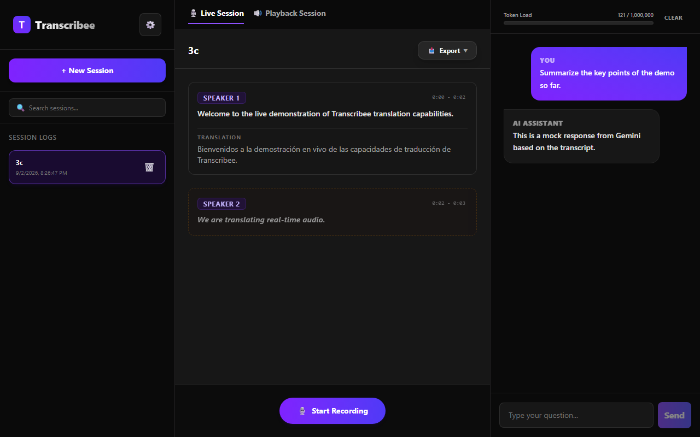
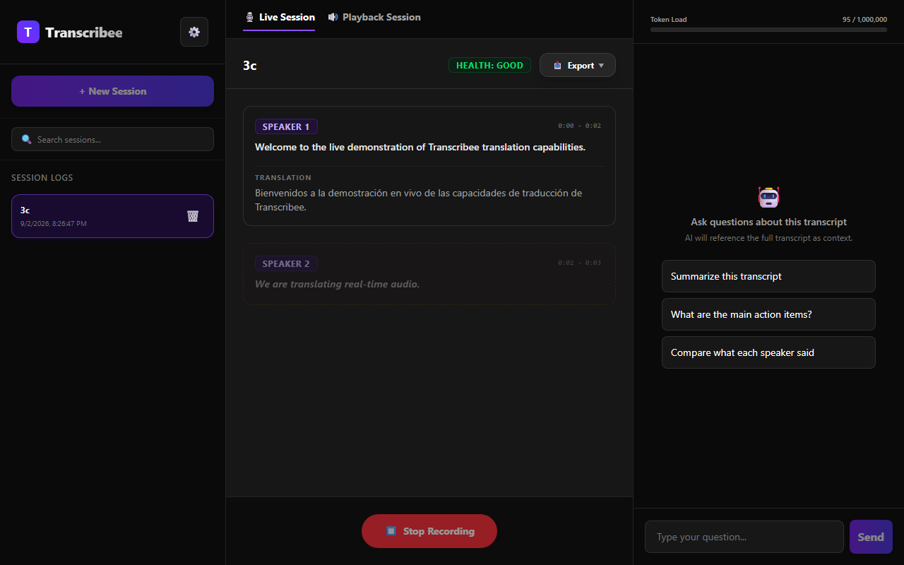
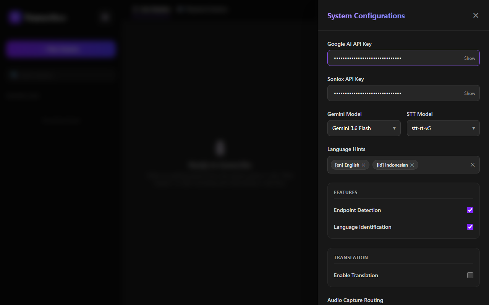
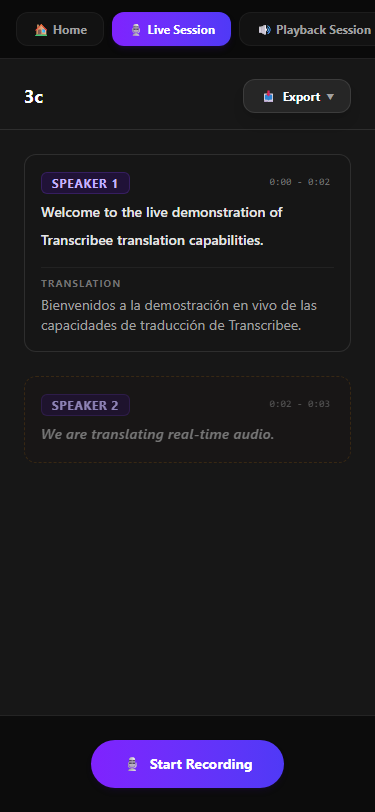
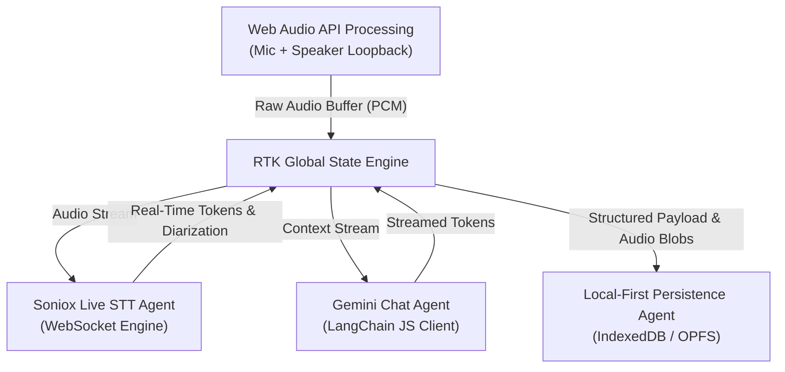

# Transcribee 🐝

> **Local-First, Real-Time Multilingual Code-switching Audio Transcriber, Diarization, Translation, Playback, & AI Chat.**

Transcribee is a browser-only web application orchestrating real-time audio streaming, speaker diarization, live translation, audio scrubbing playback, LLM chat with FIFO context management, and offline persistence—completely client-side with zero intermediary backend servers.

---

## 📸 Interface Preview

| View | Description |
| :--- | :--- |
| **Desktop Workspace**<br> | Unified layout featuring saved session management, live transcript stream with speaker indicators, and dynamic AI chat drawer. |
| **Transcription & Translation**<br> | High-frequency token streaming with finalized text refinement, concurrent translation tracks, and click-to-play audio scrubbing. |
| **System Configurations**<br> | Slide-out drawer for Soniox and Google Gemini API keys, model selections, audio routing modes, and language hints. |
| **Mobile-Responsive Layout**<br> | Responsive viewport navigation collapsing auxiliary panels into fluid tabs focused on live transcription. |

---

## ⚡ Core Features

- **Audio Capture & Loopback Mixing:** Captures microphone (`getUserMedia`) and system audio (`getDisplayMedia`), mixing to 16kHz/44.1kHz linear PCM mono stream or routing single tracks.
- **Soniox Live STT Client:** Full-duplex WebSocket client streaming real-time tokens, speaker diarization IDs, and translation tracks directly to Redux store.
- **Token-Level Audio Scrubbing:** Correlates transcribed words to exact audio offsets (`start_ms`, `duration_ms`) for split-second audio playback from local cache.
- **Smart FIFO Context Manager:** Client-side token counting with visual warning at **85%** capacity and automated First-In, First-Out truncation at **100%** preserving speaker turn boundaries.
- **In-Browser Gemini Chat:** Context-aware assistant via LangChain JS streaming responses against accumulated session transcripts.
- **Local-First Persistence:** Complete offline persistence for audio buffers, transcripts, translations, and chat histories via IndexedDB / OPFS.

---

## 🛠️ Architecture Overview



---

## 🚀 Quickstart

### Prerequisites
- Node.js (v18+)
- npm or bun

### 1. Install Dependencies
```bash
npm install
# or
bun install
```

### 2. Start Development Server
```bash
npm run dev
# or
bun run dev
```
Open [http://localhost:3000](http://localhost:3000).

### 3. Running End-to-End Tests
Playwright validates full user workflows (recording, transcription, translation, playback, AI chat, persistence):
```bash
npm test
# or
bun test
```
