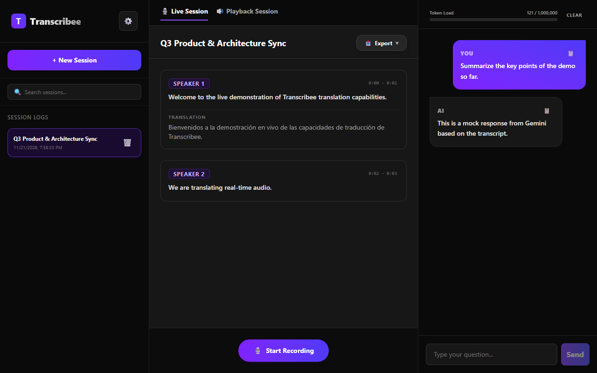
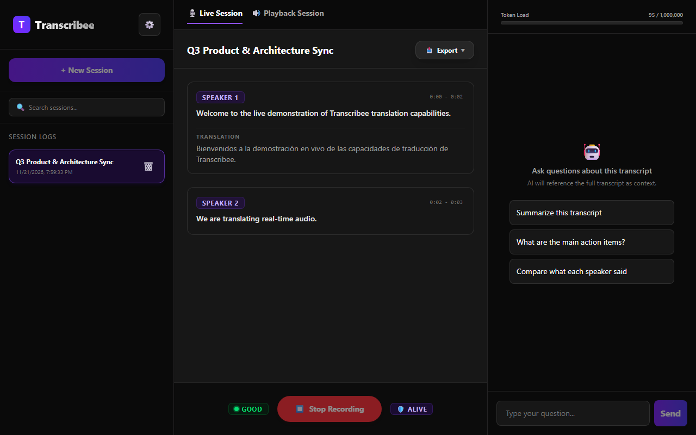
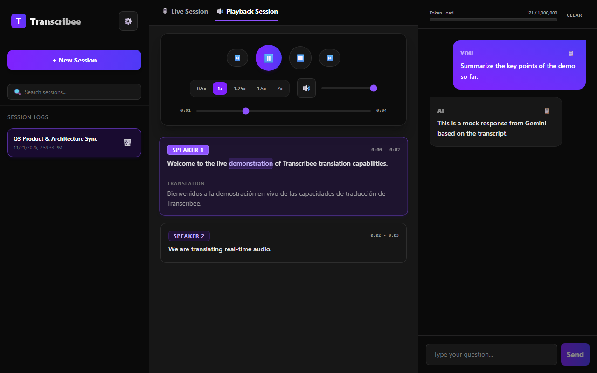
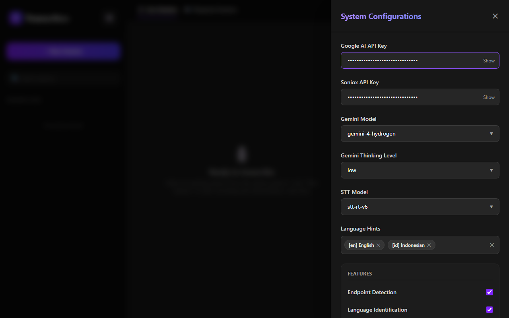
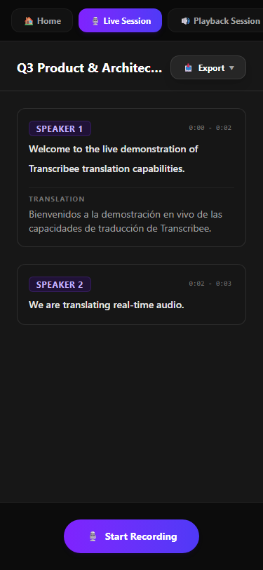
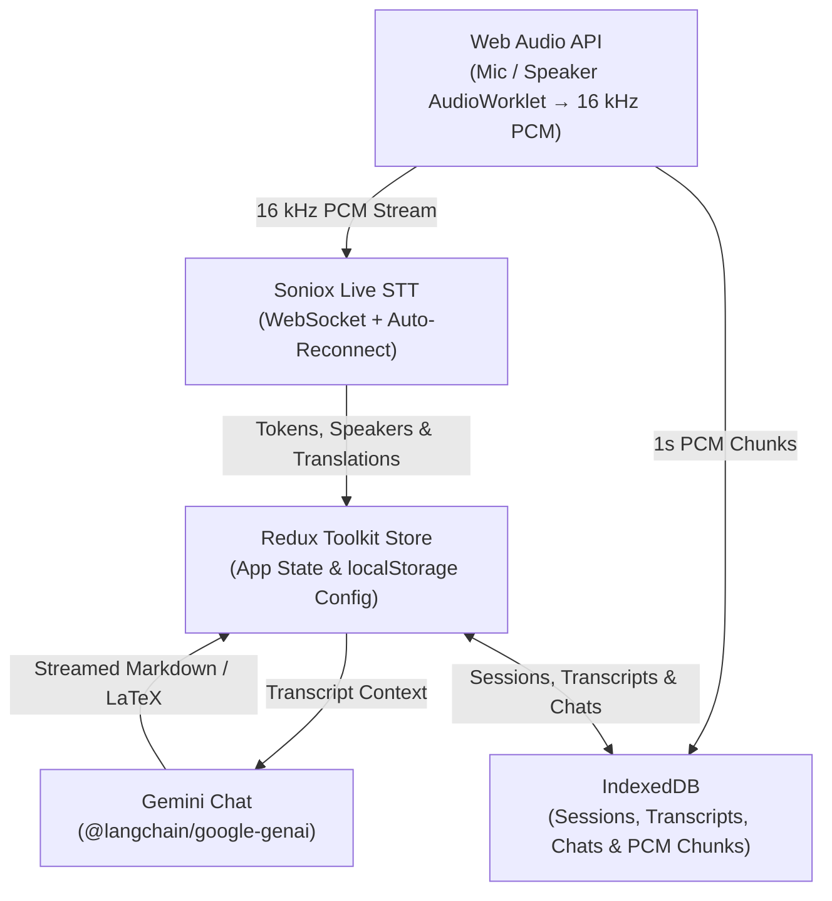

# Transcribee 🐝

> **Local-first, real-time multilingual transcription, speaker diarization, live translation, synchronized playback, and AI chat — running entirely in your browser.**

No intermediary backend required. Your browser connects directly to Soniox for real-time speech-to-text and Google Gemini for transcript-aware chat, while storing all sessions, audio, and history locally.

---

## 📸 Interface Preview

| View | Highlights |
| :--- | :--- |
| **Desktop Workspace**<br> | Resizable three-pane layout with session history, live/playback tabs, and streaming AI chat. |
| **Live Transcription & Translation**<br> | Diarized speaker blocks, concurrent translations, live stream status, and click-to-play word audio. |
| **Playback & Scrubbing**<br> | Full-session WAV player with 0.5x–2.0x speed, ±5s skip, timeline scrubbing, and auto-scrolling synced transcripts. |
| **System Configurations**<br> | Slide-out drawer for API keys, Gemini & STT models, thinking level, 60 language hints, translation modes, audio routing, and keep-awake settings. |
| **Mobile Layout**<br> | Responsive tabbed navigation across Sessions, Live Session, Playback Session, and AI Chat. |

---

## ⚡ Features

- **Flexible Audio Capture:** Captures microphone (`getUserMedia`), system audio (`getDisplayMedia`), or both mixed via `AudioWorklet`, downsampled to 16 kHz mono 16-bit PCM with live mid-recording rerouting.
- **Live Multilingual STT & Translation:** Connects directly to Soniox WebSocket (`wss://stt-rt.soniox.com/transcribe-websocket`) with speaker diarization, language identification, endpoint detection, 60 language hints, and one-way or two-way translation.
- **Background Resilience:** Screen Wake Lock, Media Session lock-screen controls, inaudible audio keep-alive, and a Web Worker sleep-wake detector paired with automatic WebSocket reconnection (~30s audio buffer).
- **Synchronized Playback & Scrubbing:** Click any word or timestamp to replay that audio slice in Live view, or switch to Playback view for full WAV playback (0.5x–2.0x speed, ±5s skip, volume, synced scroll).
- **Context-Aware Gemini Chat:** Streams answers in-browser via `@langchain/google-genai` with configurable model & thinking level, Markdown/KaTeX rendering, cancel support, and a token meter (warns at **85%**, non-destructively drops oldest prompt turns at **100%**).
- **Local-First Storage & Export:** Persists sessions, transcripts, chats, and 1s PCM audio chunks in **IndexedDB** (with settings in `localStorage`), and exports **`.wav`**, **`.srt`**, and **`.json`**.

---

## 🛠️ Architecture



**Tech Stack:** Next.js 16 · React 19 · TypeScript · Tailwind CSS 4 · Redux Toolkit · Zod · React Hook Form · LangChain (`@langchain/google-genai`) · IndexedDB · Playwright

---

## 🚀 Quickstart

### Prerequisites
- **Node.js 20.9+** and/or **Bun**
- A **Soniox API key** (for live transcription) and optionally a **Google AI API key** (for AI chat), configured in the in-app **⚙️ Settings** drawer

### Install & Run
```bash
bun install      # or: npm install
bun run dev      # or: npm run dev
```
Open [http://localhost:3000](http://localhost:3000), open **⚙️ Settings** to add your API keys, and start a session.

### Run End-to-End Tests
Playwright tests cover recording, transcription, translation, playback, export, chat, resizable panels, background keep-alive, mobile layout, and persistence:
```bash
bun run test     # Playwright webServer uses Bun to build & serve the app
```
